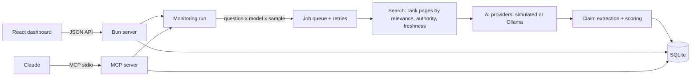

# AI Reputation Monitor

A small, fully local, zero-cost MVP of an **AI search reputation** platform: it measures what AI answer engines say about a company, finds the sources behind those answers, and shows whether publishing accurate information changes them.

Built with **TypeScript, Bun, React and SQLite**, plus an **MCP server** so Claude can query the data. It runs on your laptop with simulated AI tools, or with a real open-source LLM through [Ollama](https://ollama.com).

> The client in the demo, "Nova Pay", and every website and person in it are fictional.

## The problem

People increasingly ask ChatGPT, Gemini or Perplexity about a company before reading anything else. Those tools answer from what they read on the web, so an old or planted story can become "the AI's view" of a company. Nobody can edit an AI model directly. What you can do is:

1. **Monitor:** ask every AI tool the questions stakeholders ask, many times, because answers vary.
2. **Explain:** extract the claims, score them against the facts, and see which sites the AI relies on.
3. **Act:** place accurate information in sources the AI trusts.
4. **Report:** re-run and show the change over time.

This repo implements that loop end to end.

## Architecture



| Piece | File | What it does | Production equivalent |
|---|---|---|---|
| Data model | `src/db.ts` | Clients, facts, questions, web pages, runs, answers, citations, claims | PostgreSQL (Aurora) + S3 for raw evidence |
| Demo data | `src/seed.ts` | Fictional client with an outdated story and a planted false claim | Client onboarding |
| Search | `src/search.ts` | Picks the pages an AI tool would read | Live retrieval in ChatGPT search, Perplexity, AI Overviews |
| Providers | `src/providers.ts` | Simulated AI tools, or a real LLM via Ollama | OpenAI, Anthropic, Google, Perplexity APIs |
| Monitoring run | `src/monitor.ts` | Fans out jobs with concurrency, retries and idempotent writes | EventBridge + SQS + Bun workers on ECS Fargate, dead-letter queue |
| Scoring | `src/extract.ts` | Labels each claim accurate, outdated or false | LLM structured output + analyst methodology |
| Insights | `src/insights.ts` | Narrative scores, share of voice by domain, per-model breakdown | Same queries, materialised views |
| API + UI | `src/server.ts`, `web/` | Bun serves the API and bundles the React app | API on Fargate behind an ALB, React Router SSR or S3 + CloudFront |
| MCP server | `src/mcp.ts` | Tools Claude can call: snapshot, risky claims, citations, run | MCP over streamable HTTP with OAuth |

The React app imports the API's response type (`Overview`), so the front end and back end share one contract.

## Quick start

Requires [Bun](https://bun.sh) 1.2 or later.

```bash
bun install
bun run dev
```

Open http://localhost:3000, then:

1. **Run monitoring.** 4 questions x 3 AI tools x 5 samples = 60 answers. Most mention the outdated 2021 investigation, and many repeat the planted fraud claim.
2. **Publish correction.** Adds an accurate article to a high-authority site in the simulated web.
3. **Run monitoring** again. The share of answers with a false or outdated claim drops sharply, and the new site leads the share of voice.

From the terminal instead:

```bash
bun run seed      # reset the demo data
bun run monitor   # one monitoring run, printed as tables
```

## Use a real local LLM (free)

```bash
brew install ollama
ollama serve
ollama pull qwen2.5:1.5b
```

When Ollama is running and the model is present, `ollama:qwen2.5:1.5b` joins the simulated providers automatically. Set `OLLAMA_MODEL` to use another model, and `SAMPLES` to change how often each question is asked.

## Ask Claude about the data (MCP)

Add the server to Claude Code:

```bash
claude mcp add ai-reputation-monitor -- bun run --cwd "$PWD" mcp
```

Then ask, for example, "Use trace_citations for nova-pay: which sites drive the AI answers?"

Tools: `entity_snapshot`, `find_risky_claims`, `trace_citations`, `run_monitoring`.

## Limits of the MVP

- Search runs over a handful of seeded pages, not the real web.
- Simulated providers build answers from the pages they read. They show the mechanics, not real model behaviour.
- Claim scoring uses transparent rules so every verdict is explainable. A production system would use an LLM with structured output, checked against a client-approved fact base.
- No authentication or multi-tenant isolation.

## License

MIT
